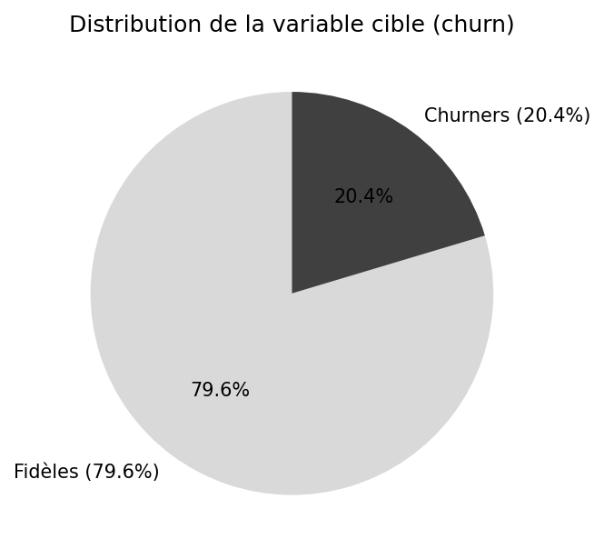
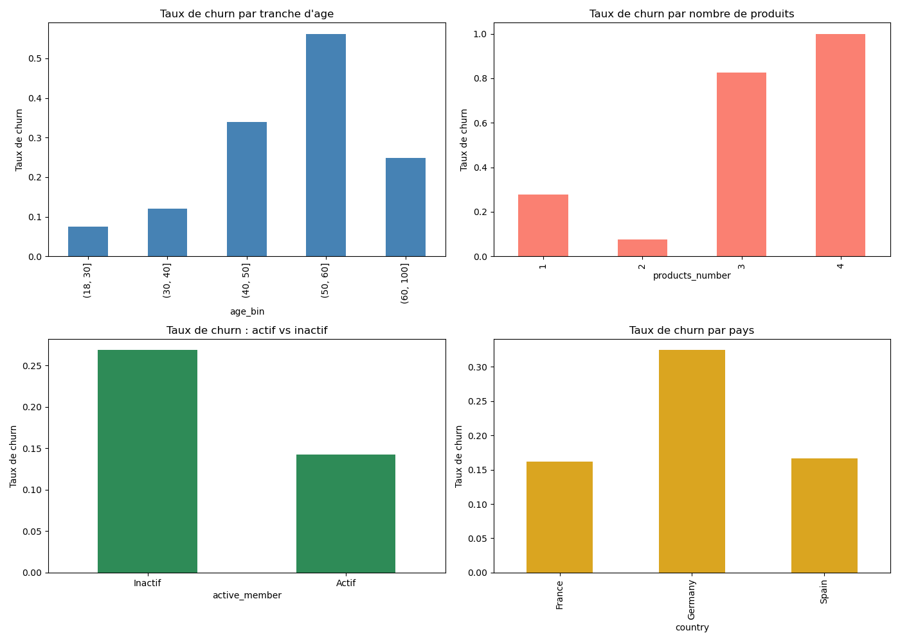
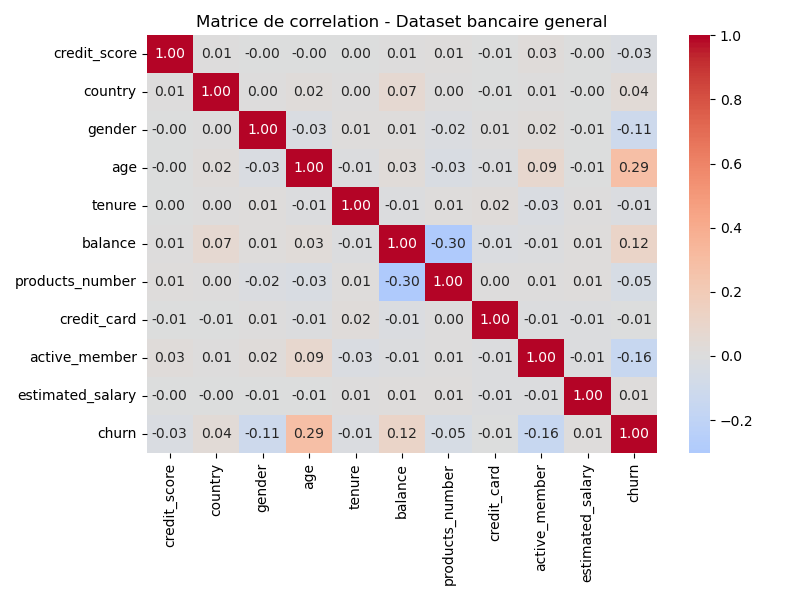
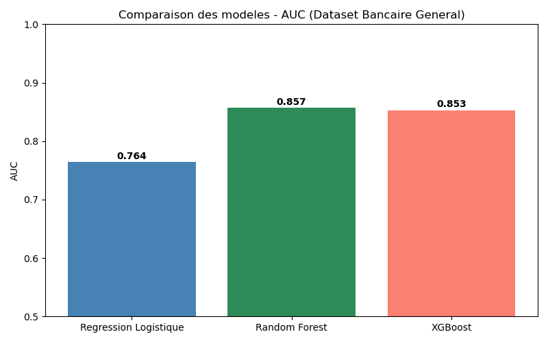
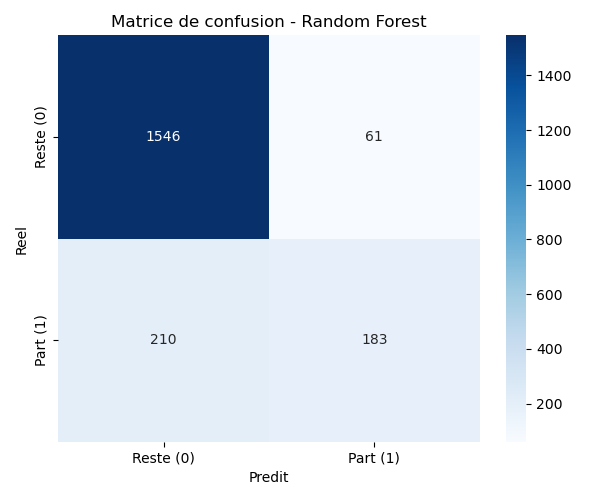

#  Prédiction de l'Attrition des Clients Bancaires

**Machine Learning | Deep Learning | Explainable AI (XAI) | Customer Churn Prediction**

**Projet de Fin d'Année (PFA) — ENSAO Oujda**  
**Filière : Management et Gouvernance des Systèmes d'Information (MGSI)**  
**Année universitaire : 2025–2026**

---

##  Présentation du projet

Dans un secteur bancaire de plus en plus concurrentiel, la fidélisation des clients représente un enjeu stratégique majeur.

L'attrition client, également appelée *Customer Churn*, désigne le phénomène par lequel un client cesse d'utiliser les services d'une entreprise.

Ce projet a pour objectif de développer une approche prédictive permettant d'identifier les clients présentant un risque de départ, à partir de leurs caractéristiques et de leurs comportements.

Il combine plusieurs techniques de **Machine Learning**, de **Deep Learning** et d'**Intelligence Artificielle Explicable (XAI)** afin de transformer les prédictions en informations utiles pour la prise de décision.

##  Objectifs du projet

- Analyser les caractéristiques des clients bancaires.
- Identifier les facteurs associés au risque d'attrition.
- Développer plusieurs modèles de classification.
- Comparer les performances des algorithmes.
- Interpréter les prédictions grâce à SHAP.
- Explorer des scénarios contrefactuels avec DiCE.
- Proposer des pistes d'amélioration de la fidélisation client.

##  Jeux de données

Le projet utilise deux datasets distincts provenant de Kaggle.

| Dataset | Description |
|---|---|
| Bank Customer Churn Prediction | Données sur les caractéristiques des clients bancaires et leur attrition |
| Credit Card Churn | Données relatives aux clients détenteurs de cartes bancaires et à leur risque de départ |

L'utilisation de deux jeux de données permet d'étudier la problématique de l'attrition dans différents contextes bancaires.

**Fichiers :**

- `Bank Customer Churn Prediction.csv`
- `credit_card_churn.csv`

**Sources :** Kaggle — liens exacts des deux datasets à ajouter, ainsi que leurs licences respectives.

##  Méthodologie

Le projet suit une démarche structurée en plusieurs étapes.

### 1. Analyse exploratoire des données (EDA)

L'analyse exploratoire permet de comprendre les caractéristiques des datasets, d'étudier la répartition des clients et d'examiner les relations entre les variables.

Elle comprend notamment :

- L'exploration des dimensions et des types de variables.
- L'analyse des distributions.
- L'étude de la variable cible.
- L'analyse des corrélations.
- La visualisation des caractéristiques des clients.

### 2. Préparation des données

Cette phase prépare les données pour leur utilisation par les modèles prédictifs.

Elle comprend les transformations nécessaires, notamment le traitement des variables catégorielles et numériques selon les besoins des algorithmes.

### 3. Modélisation prédictive

Quatre approches sont étudiées :

| Modèle | Type | Rôle |
|---|---|---|
| Logistic Regression | Machine Learning | Modèle de référence pour la classification |
| Random Forest | Machine Learning | Ensemble d'arbres de décision |
| XGBoost | Machine Learning | Modèle d'ensemble basé sur le gradient boosting |
| Multi-Layer Perceptron (MLP) | Deep Learning | Réseau de neurones pour la classification |

### 4. Évaluation des modèles

Les modèles sont comparés à l'aide de métriques de classification, avec une attention particulière portée à l'**AUC-ROC**.

L'objectif est d'évaluer leur capacité à distinguer les clients susceptibles de quitter leur banque de ceux susceptibles de rester.

### 5. Intelligence artificielle explicable (XAI)

Au-delà de la performance prédictive, ce projet cherche à rendre les résultats des modèles plus compréhensibles.

**SHAP — SHapley Additive exPlanations**

SHAP permet d'étudier l'influence des variables sur les prédictions, au niveau global et individuel.

**DiCE — Diverse Counterfactual Explanations**

DiCE permet d'explorer des scénarios contrefactuels en recherchant des changements de caractéristiques susceptibles de modifier la prédiction d'un modèle.

Ces outils contribuent à rendre l'analyse plus interprétable et plus utile dans un contexte métier.

##  Visualisation des résultats

### Distribution de l'attrition



### Analyse exploratoire des données



### Matrice de corrélation



### Comparaison des modèles



### Matrice de confusion



##  Résultats prédictifs

Les résultats suivants concernent le **premier dataset**, sur la base des valeurs AUC-ROC obtenues lors de l'exécution du notebook.

| Modèle | AUC-ROC |
|---|---:|
| Logistic Regression | 0,764 |
| Random Forest | **0,857** |
| XGBoost | 0,853 |
| MLP (Deep Learning) | 0,853 |

Dans cette comparaison, **Random Forest obtient la meilleure AUC-ROC**, avec un score de 0,857.

Ces résultats illustrent l'intérêt des méthodes d'ensemble pour la prédiction du churn sur ce jeu de données.

Les analyses du second dataset sont disponibles dans le notebook.

*Remarque : les performances correspondent aux expérimentations réalisées sur les jeux de données utilisés. Elles ne constituent pas une validation sur des données bancaires réelles en production.*

##  Interprétation métier et fidélisation

Les résultats du projet peuvent soutenir une démarche de fidélisation fondée sur les données.

Les principales pistes d'utilisation sont :

- Identifier les clients présentant un risque élevé de départ.
- Comprendre les facteurs associés à ce risque.
- Prioriser les actions de fidélisation.
- Adapter les offres et les interactions selon les profils.
- Accompagner la prise de décision par des explications interprétables.

Ces recommandations constituent des pistes d'action et ne démontrent pas, à elles seules, l'efficacité réelle d'une campagne de fidélisation.

##  Technologies utilisées

| Catégorie | Technologies |
|---|---|
| Langage | Python |
| Environnement | Jupyter Notebook |
| Manipulation des données | Pandas, NumPy |
| Visualisation | Matplotlib, Seaborn |
| Machine Learning | Scikit-learn, XGBoost |
| Deep Learning | TensorFlow / Keras |
| Explainable AI | SHAP, DiCE |
| Versionnement | GitHub |

##  Structure du projet

```text
Bank-Customer-Churn-Prediction/
│
├── PFA_Churn_Bancaire_ENSAO.ipynb
│
├── Bank Customer Churn Prediction.csv
├── credit_card_churn.csv
│
├── requirements.txt
├── README.md
├── .gitignore
│
├── fig1_churn_distribution.png
├── eda_dataset1_resultats.png
├── eda_dataset1_heatmap.png
├── ml_dataset1_comparaison.png
└── ml_dataset1_confusion.png
```

*La structure présente les principaux fichiers du projet. D'autres graphiques peuvent également être disponibles dans le dépôt.*

##  Installation et exécution

### 1. Cloner le repository

```bash
git clone https://github.com/YasmineLr/Bank-Customer-Churn-Prediction.git
```

### 2. Accéder au dossier

```bash
cd Bank-Customer-Churn-Prediction
```

### 3. Installer les dépendances

```bash
python -m pip install -r requirements.txt
```

Il est recommandé d'utiliser un environnement Python virtuel ou un environnement Conda dédié.

### 4. Lancer Jupyter Notebook

```bash
jupyter notebook
```

### 5. Exécuter le projet

Ouvrir le fichier :

`PFA_Churn_Bancaire_ENSAO.ipynb`

Exécuter les cellules dans l'ordre.

Les fichiers CSV doivent être présents dans le même répertoire que le notebook.

##  Perspectives d'amélioration

Plusieurs prolongements peuvent être envisagés :

- Optimisation des hyperparamètres.
- Évaluation sur de nouveaux jeux de données.
- Développement d'une interface interactive de prédiction.
- Déploiement du modèle sous forme d'application.
- Intégration dans un tableau de bord décisionnel.
- Évaluation de l'impact réel des stratégies de fidélisation.

##  Contexte académique

Ce projet a été réalisé dans le cadre du **Projet de Fin d'Année (PFA)** de la filière **Management et Gouvernance des Systèmes d'Information (MGSI)** à l'**École Nationale des Sciences Appliquées d'Oujda (ENSAO)**, Université Mohammed Premier, Maroc.

Il mobilise des compétences en analyse de données, modélisation prédictive, intelligence artificielle explicable et aide à la décision.

---

**Projet académique — Data Science & Artificial Intelligence for Banking Customer Retention**
